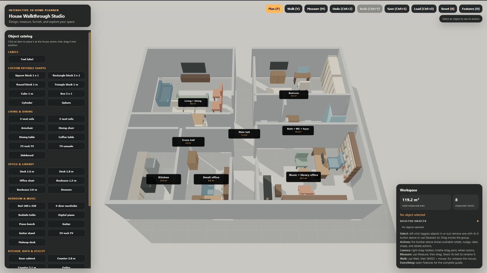

# House Walkthrough Studio

A browser-based 3D home planner for arranging furniture, shaping a floor plan, measuring rooms, and walking through the layout at full scale.

## Run the planner

Open `index.html` in Firefox or another modern browser. The project includes its 3D engine locally and works without a build step or external service.

## What you can do

- Arrange the example home or start from a blank plan.
- Add furniture, appliances, labels, modular walls, and editable basic shapes from the catalog.
- Select and move several objects together, rotate them around their shared center, and adjust shape color, scale, or elevation.
- Draw room measurements in square meters and see the combined measured area and room count in the Workspace panel.
- Switch between floor-plan editing and first-person walkthrough mode.
- Save and load layouts as JSON files; changes are also saved in the browser's local storage.

The example arrangement is a starting point. Walls and objects can be moved, and the measured total comes only from the room measurements you draw.

## Controls

| Action | Control |
| --- | --- |
| Floor-plan editing / walkthrough | `P` / `V` |
| Rotate camera / pan camera | Right-drag / middle-drag |
| Zoom | Mouse wheel |
| Select or deselect an object | Left-click |
| Move selected objects | Left-drag |
| Move selected objects by 10 cm | Arrow keys |
| Rotate selected objects | `R` |
| Set object elevation / scale | `E` / `K` |
| Edit a selected text or room label | `T` |
| Delete selected objects | `Delete` or `Backspace` |
| Measure a room | `M`, then drag a rectangle |
| Undo / redo | `Ctrl+Z` / `Ctrl+Y` (`Ctrl+Shift+Z` also redoes) |
| Save / load a layout | `Ctrl+S` / `Ctrl+O` |
| Reset the example layout | `0` |
| Open the full feature guide | `H` |

In walkthrough mode, use `W`, `A`, `S`, and `D` to move and the mouse to look around. Press `Esc` to release the mouse.
